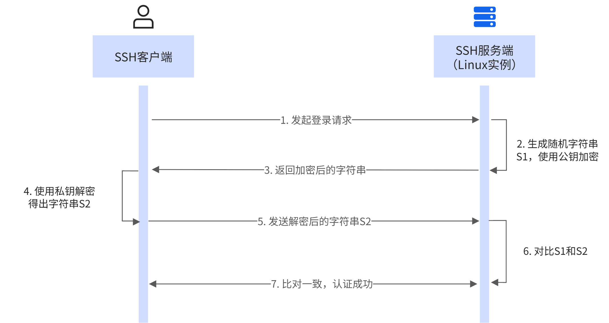

* TOC
{:toc}

---

## 一、什么是 SSH

SSH（Secure Shell）是一种加密的网络协议，用于在不安全的网络中安全地远程登录和管理计算机。它通过加密技术保护数据传输，防止窃听、连接劫持和其他攻击。

### 1.1 SSH 的核心功能

- **远程登录**：安全地连接到远程服务器并执行命令
- **文件传输**：通过 SCP/SFTP 协议安全地传输文件

### 1.2 身份认证原理

SSH 支持多种认证方式，最常用的有两种：

**密码认证**：用户输入用户名和密码，服务器验证密码是否正确。简单直接，但密码容易被暴力破解或窃听。

**公钥认证**（更安全）：使用密钥对进行身份验证

1. **生成密钥对**：用户在本地运行 `ssh-keygen`，生成一对密钥
   - **私钥**（如 `id_ed25519`）：保存在本地客户端，绝对不能泄露
   - **公钥**（如 `id_ed25519.pub`）：复制到服务器的 `~/.ssh/authorized_keys`

2. **连接认证**：客户端连接服务器时
   - 服务器用公钥加密一段挑战数据，发给客户端
   - 客户端用私钥解密并回应
   - 服务器验证回应正确，认证成功

   <details>
    <summary> 这里借用一下阿里云 ECS 的文档中的原理图 </summary>
    <div style="text-align: center">
        
        <em>密钥对认证原理</em>
    </div>
    </details>

公钥认证无需传输密码，更加安全，推荐使用。

---

## 二、SSH 配置步骤

### 2.1 本地配置步骤

#### 2.1.1 生成密钥对（如果还没有）

```bash
# Windows PowerShell 或 Git Bash
ssh-keygen -t ed25519 -C "your_email@example.com"
```

**生成两个文件：**
- `~/.ssh/id_ed25519` - **私钥**（永远留在本地，不能泄露）
- `~/.ssh/id_ed25519.pub` - **公钥**（需要放到远程机器上）

> 远程机器可以是虚拟机，也可以是云服务提供商的实例（如 AWS EC2、阿里云 ECS 等），只要能 ping 通的设备就可以；
{: .prompt-info }

#### 2.1.2 将公钥上传到远程机器

**方法 A：使用 `ssh-copy-id`（最简单）**

```bash
# 第一次需要输入密码
ssh-copy-id -i ~/.ssh/id_ed25519.pub user@远程机器IP
```

**方法 B：手动复制**

```bash
# 1. 查看公钥内容
cat ~/.ssh/id_ed25519.pub

# 2. 复制输出的内容（类似 ssh-ed25519 AAAA...）

# 3. SSH 登录远程机器（用密码）
ssh user@远程机器IP

# 4. 在远程机器上粘贴公钥（见下面的"远程机器操作"）
```

### 2.2 远程机器操作

#### 2.2.1 确保 `.ssh` 目录存在

```bash
mkdir -p ~/.ssh
chmod 700 ~/.ssh
```

#### 2.2.2 创建或编辑 `authorized_keys` 文件

```bash
vim ~/.ssh/authorized_keys
```

**粘贴公钥内容**（每行一个公钥）：

```
ssh-ed25519 AAAAC3NzaC1lZDI1NTE5AAAAIGxxxxxx user@local
ssh-rsa AAAAB3NzaC1yc2EAAAADAQABxxxxxx another-user@local
```

#### 2.2.3 设置权限

```bash
chmod 600 ~/.ssh/authorized_keys
```

#### 2.2.4 确保 SSH 配置正确

```bash
# 检查 SSH 配置
sudo grep -E "PubkeyAuthentication|AuthorizedKeysFile" /etc/ssh/sshd_config
```

**应该显示：**

```
PubkeyAuthentication yes
AuthorizedKeysFile .ssh/authorized_keys
```

**如果不是，修改 `/etc/ssh/sshd_config` 中对应配置项，然后重启服务。**

#### 2.2.5 重启远程机器 SSH 服务

```bash
# Ubuntu/Debian
sudo systemctl restart ssh

# CentOS/RHEL/Alibaba Cloud Linux
sudo systemctl restart sshd
```

### 2.3 验证连接

#### 2.3.1 在本地测试：

```bash
# 使用密钥文件连接
ssh -i ~/.ssh/id_ed25519 user@服务器IP

# 如果配置了 SSH config（见 2.4），直接用别名
ssh myserver
```

### 2.4 配置 SSH 别名（可选）

为了避免每次都输入完整的连接参数，可以在本地创建 SSH 配置文件：

**配置文件位置：**
- Windows: `C:\Users\你的用户名\.ssh\config`
- Linux/Mac: `~/.ssh/config`

用文本编辑器打开，添加以下内容：

```
Host myserver
    HostName 服务器IP
    User root
    Port 22
    IdentityFile ~/.ssh/id_ed25519
```

配置完成后，直接用别名连接：

```bash
ssh myserver
```

VSCode 的 Remote-SSH 插件会自动读取这个配置，在"Connect to Host"列表中显示 `myserver`，点击即可连接。