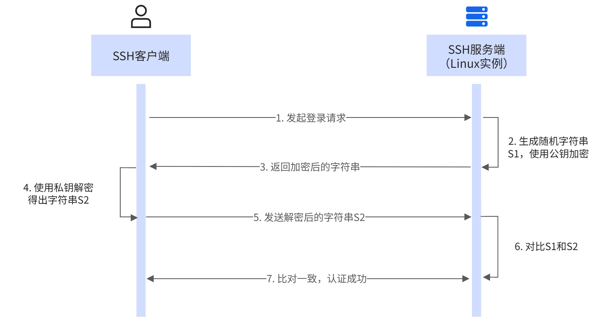

## 什么是 SSH

SSH（Secure Shell）是一种加密的网络协议，用于在不安全的网络中安全地远程登录和管理计算机。它通过加密技术保护数据传输，防止窃听、连接劫持和其他攻击。

### SSH 的核心功能

- **远程登录**：安全地连接到远程服务器并执行命令
- **文件传输**：通过 SCP/SFTP 协议安全地传输文件
- **端口转发**：将远程服务的端口安全地映射到本地
- **隧道加密**：为其他应用协议提供加密通道

### 身份认证原理

SSH 支持多种认证方式，最常用的有两种：

**密码认证**：用户输入用户名和密码，服务器验证密码是否正确。简单直接，但密码容易被暴力破解或窃听。

**公钥认证**（更安全）：使用密钥对进行身份验证

1. **生成密钥对**：用户在本地运行 `ssh-keygen`，生成一对密钥
   - **私钥**（如 `id_ed25519`）：保存在本地客户端，绝对不能泄露
   - **公钥**（如 `id_ed25519.pub`）：复制到服务器的 `~/.ssh/authorized_keys`

2. **连接认证**：客户端连接服务器时
   - 服务器用公钥加密一段挑战数据，发给客户端
   - 客户端用私钥解密并回应
   - 服务器验证回应正确，认证成功

   

    
 这里借用一下阿里云 ECS 的文档中的原理图 

    

        
        <em>密钥对认证原理</em>
    

    

公钥认证无需传输密码，更加安全，推荐使用。

---

